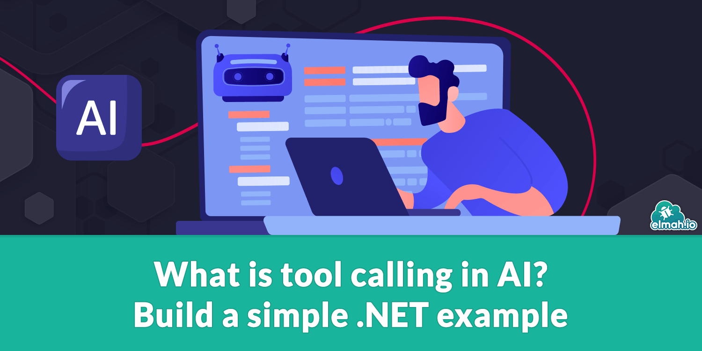

[https://blog.elmah.io/what-is-tool-calling-in-ai-build-a-simple-net-example/](https://blog.elmah.io/what-is-tool-calling-in-ai-build-a-simple-net-example/)

Tool calling lets an LLM ask your app to run functions. See how it works step by step with a flight booking example and C# tool definitions.
