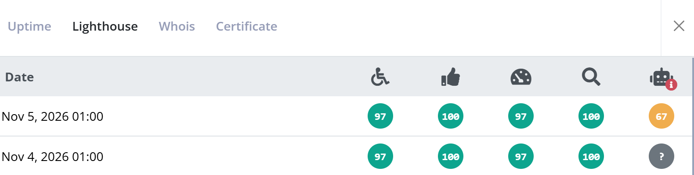

Lighthouse checks on uptime checks now include the Agentic Browsing score. The category is new in Lighthouse and measures how well AI agents can use your website, for example when they browse, read, and interact with pages on a user's behalf. Like the other categories, it's reported on a scale from 0 to 100.

The score shows up as a new column with a robot icon next to Accessibility, Best Practices, Performance, and SEO on the Lighthouse tab of an uptime check. Checks that ran before today don't have a score, and show a question mark.

Agentic Browsing is still an experimental category in Lighthouse. For that reason, it isn't part of the combined score used to generate Lighthouse recommendations.