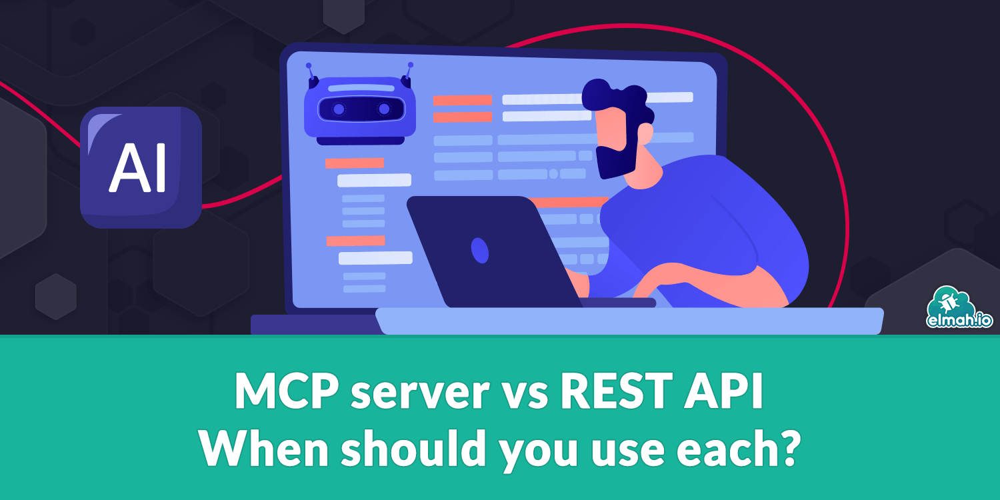

[https://blog.elmah.io/mcp-server-vs-rest-api-when-should-you-use-each/](https://blog.elmah.io/mcp-server-vs-rest-api-when-should-you-use-each/)

MCP and REST APIs solve different problems. Learn how they differ, where each one fits, and why most teams end up running both side by side.
