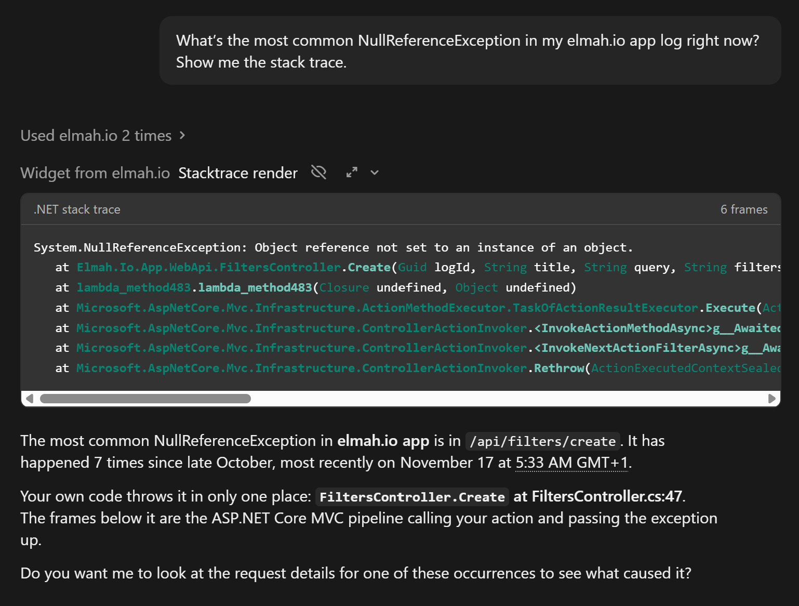

A stack trace in an AI client is normally plain monospace text. The elmah.io MCP server can now show it formatted and syntax highlighted instead, for both .NET and JavaScript.

This is the first time the MCP server returns an interface and not only text. It uses MCP Apps, an extension to MCP that lets a server provide a small HTML view for the AI client to display inside the conversation. Ours is built with our open source libraries [netStack.js](https://github.com/elmahio/netStack.js) and [jsStack](https://github.com/elmahio/jsStack).

Ask your AI client to show a stack trace from one of your logs, or paste one from your own code. The client calls a new tool, `stacktrace_render`, and the formatted trace appears in the conversation. Long lines scroll sideways, so each frame stays on one line.

